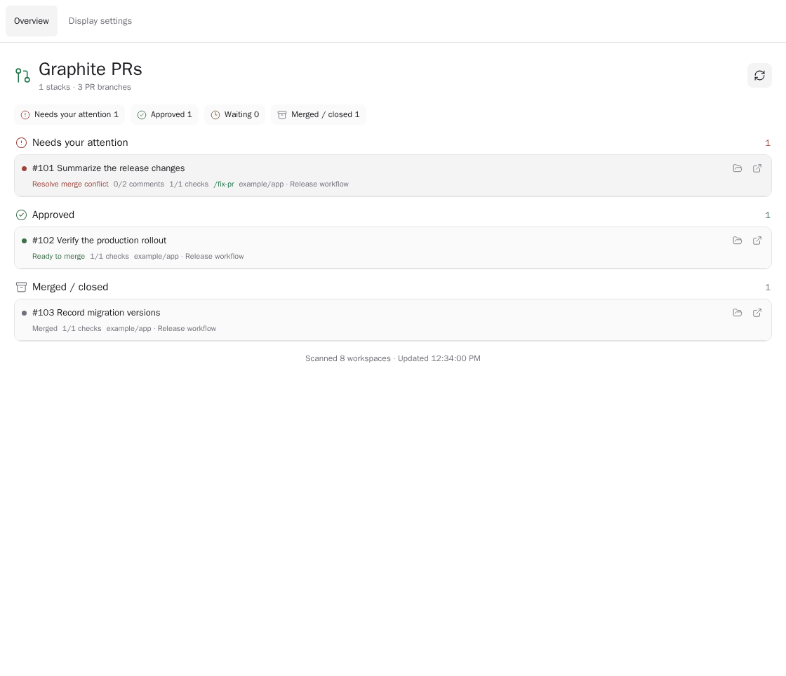

# paseo-graphite

[](https://www.npmjs.com/package/paseo-graphite)
[](https://www.npmjs.com/package/paseo-graphite)
[](https://paseo.sh)
[](LICENSE)

> [!NOTE]
> This plugin is archived and no longer maintained. Existing installs keep working, but it will not get updates and is no longer listed in the Paseo plugin directory.

See each workspace's real Graphite stack and which PRs need action, are ready to merge, are waiting, or are done.



Screenshots use synthetic data.

## Install

```sh
paseo plugin install paseo-graphite
```

Needs `git`, the Graphite CLI (`gt`) initialized in the repository, and an authenticated GitHub CLI (`gh`) for live PR status.

## Use

- **Graphite PRs** in the sidebar or Command Center is an inbox across active workspaces, grouped into needs attention, approved, waiting and completed.
- The `Stack N · Fix M` header button, the composer pill and `/pr-stack` open the stack for the current workspace. Each PR is one compact row with its action state, resolved review threads and checks.
- **Fix All** starts a separate agent in the workspace with the latest agent's provider settings. When there is review feedback, its prompt starts with your own `/fix-pr` workflow.
- Agents can read their own stack, review blockers and checks with `graphite_workspace_stack`. They cannot submit, merge or change PRs.

Header and composer buttons can be hidden in **Settings → Plugins → Graphite**.

## How it works

The stack comes from the Graphite CLI in the workspace. GitHub only adds reviews, unresolved threads, checks and mergeability to those branches; the plugin never guesses stack membership from PR base branches. See [PLAN.md](PLAN.md) for the product model.

## Development

```sh
npm ci
npm run verify
paseo plugin install .
paseo plugin reload paseo-graphite   # after changes
```

## License

[MIT](LICENSE) © 2026 Tom Gringauz.
