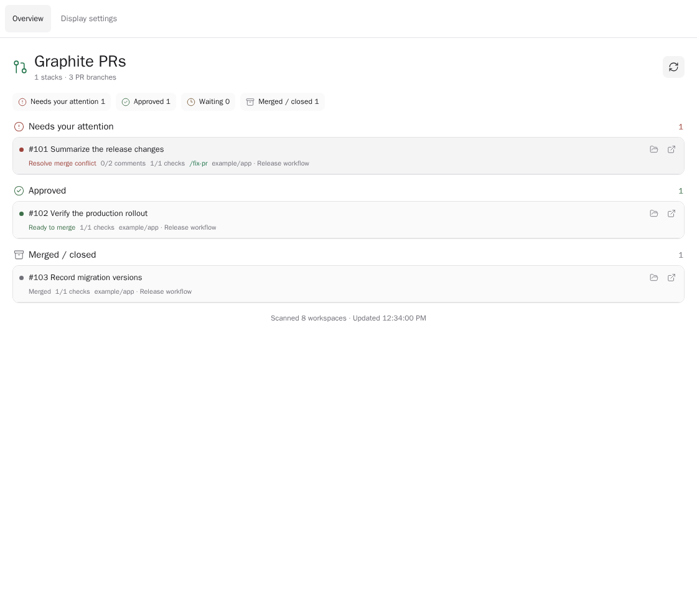

# paseo-graphite

[](https://www.npmjs.com/package/paseo-graphite)
[](https://www.npmjs.com/package/paseo-graphite)
[](https://paseo.sh)
[](LICENSE)

A trusted local Paseo plugin that shows the real Graphite stack for each workspace and tells you
whether a PR needs action, is ready to merge, is waiting, or is done.

The stack comes from the Graphite CLI in the workspace. GitHub only enriches those Graphite branches
with reviews, unresolved threads, checks, and mergeability. The plugin does not infer Graphite
membership from GitHub PR base branches.

## Install

Install from npm using the latest Paseo release:

```sh
paseo plugin install paseo-graphite
```



Screenshots use synthetic data.

## Requirements

- The latest Paseo release
- `git`
- Graphite CLI (`gt`) initialized in the repository
- authenticated GitHub CLI (`gh`) for live PR status

## Use

- Open **Graphite PRs** from Paseo's left sidebar or Command Center for an inbox across active
  workspaces, grouped into needs-attention, approved, waiting, and completed sections.
- Press the `Stack N` / `Stack N · Fix M` workspace header button.
- Press the matching composer pill beside Tasks and Subagents.
- Run `/pr-stack` in an agent composer to open the Explorer panel.
- Press **Fix All** to create a separate agent in the workspace using the latest agent's provider
  configuration. If review feedback is present, its prompt starts with your existing `/fix-pr`
  workflow. The plugin does not register or intercept `/fix-pr`.

The workspace panel is intentionally dense: each PR is a compact row with action state,
`resolved/total` review-thread count, check count, and a small Graphite link. GitHub links and
comment bodies are omitted.

## Development

```sh
npm install
npm run verify
paseo plugin install "$PWD"
paseo plugin reload paseo-graphite
paseo plugin logs paseo-graphite
```

See [PLAN.md](PLAN.md) for the product model and roadmap.

## License

[MIT](LICENSE) © 2026 Tom Gringauz.

## Navigation and display

Open this plugin from Command-K or its sidebar entry. **Overview** and **Display settings** link the main view and settings directly, without opening the Plugins settings page. Hiding a sidebar entry keeps Command-K available.

Display settings can also hide this plugin's workspace header or composer buttons independently. Hidden buttons stay hidden for newly opened workspaces; restoring them retains the latest button status.

## Paseo 0.14 agent integration

`graphite_workspace_stack` reads the calling agent’s workspace stack, review blockers and checks. It cannot submit, merge or modify a PR.

Requires Paseo **0.14.0 or newer**. Agent tools are scoped to interactive Claude
and Codex sessions; history-only opens receive none. They become available on
the next idle session open after install or reload. The agent label
`plugin-tools/enabled: "false"` opts a session out. Existing plugin data and
settings are retained.

## Other plugins

- [Defer](https://github.com/tomgrin10/paseo-defer) — Schedule messages for later delivery.
- [Smart Session](https://github.com/tomgrin10/paseo-smart-session) — Context compaction and usage insights.
- [Vitals](https://github.com/tomgrin10/paseo-vitals) — Host, agent, and Docker health.
- [Session Guard](https://github.com/tomgrin10/paseo-session-guard) — Pause at session limits and continue after reset.
- [Transfer](https://github.com/tomgrin10/paseo-transfer) — Copy or move workspaces between hosts.
- [Transcript Search](https://github.com/tomgrin10/paseo-transcript-search) — Search conversations across connected hosts.
- [Send to Paseo](https://github.com/tomgrin10/send-to-paseo) — Send GitHub and Graphite PRs to Paseo from Chrome.
- [Dispatch](https://github.com/tomgrin10/paseo-dispatch) — Route tasks to existing workspaces (development preview).

- [Follow-up](https://github.com/tomgrin10/paseo-follow-up) — Track workspace PRs, remaining tasks and completion.
